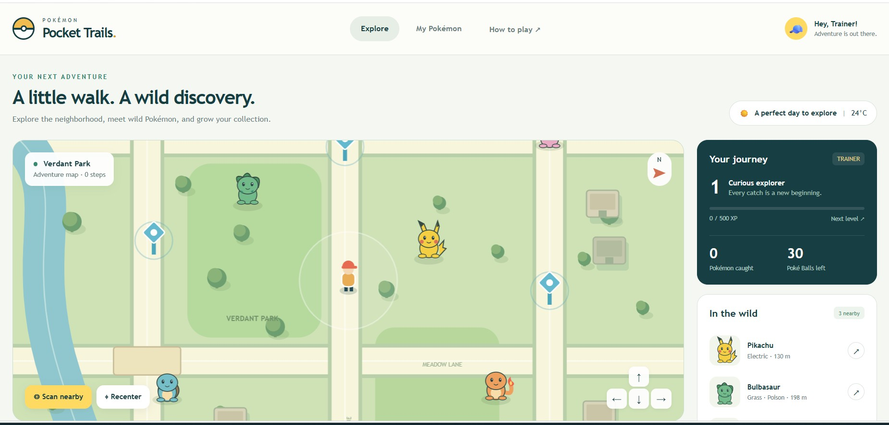
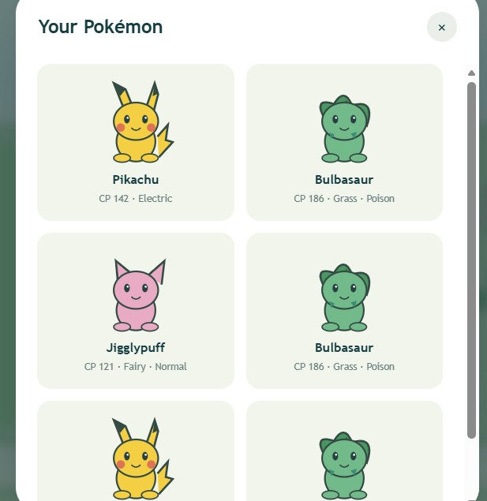

# 🧢 Pocket Trails

> **A little walk. A wild discovery.**

Pocket Trails is an interactive, Pokémon-inspired browser adventure. Explore a simulated neighborhood map, track your in-game steps, discover wild Pokémon, and grow your collection as a Trainer.

🔗 **Live Demo:** [pockettrails.vercel.app](https://pockettrails.vercel.app/)

---

## 📸 Project Previews

### 🗺️ Adventure Map & Dashboard

Track your journey, manage your Poké Balls, and scan for Pokémon in the wild.



### 🎒 Your Pokémon Collection

View all your caught Pokémon, including their Combat Power (CP) and elemental types.



---

## ✨ Features

- 🗺️ **Interactive Map** — Explore Verdant Park and the surrounding areas on a simulated game map.
- 👣 **Step & Journey Tracker** — Track in-game steps, gain XP, and level up your Trainer profile.
- ☀️ **Weather Display** — A decorative weather widget with a sample temperature.
- 📍 **In the Wild Tracker** — See nearby Pokémon, their types, and their in-game distance.
- 🎒 **Pokémon Collection** — View caught Pokémon with their CP and types.
- ⚡ **Inventory Management** — Keep track of your Poké Balls and refill at PokéStops.
- 💾 **Saved Progress** — Your collection, XP, inventory, and step count are saved in your browser.
- 🎨 **Responsive UI** — Play using a keyboard, map clicks, or on-screen movement buttons.

> **Note:** This version uses a simulated map and in-game movement. It does not use live GPS, a camera, real-world step tracking, or a live weather service.

---

## 🛠️ Tech Stack

- **HTML5** — Page structure and Canvas map rendering
- **CSS3** — Styling, layout, animations, and responsive design
- **JavaScript (ES6+)** — Movement, catching, inventory, XP, and state management
- **Local Storage** — Browser-based progress saving
- **Vercel** — Live demo hosting

---

## 🚀 Run Locally

### 1. Clone the repository

```bash
git clone https://github.com/samin-developer/Pocket-Trails.git
```

### 2. Open the project folder

```bash
cd Pocket-Trails
```

### 3. Launch the game

Open `index.html` in a modern browser. You can also use the **Live Server** extension in VS Code.

No dependency installation or build step is required.

---

## 📁 Project Structure

```text
Pocket-Trails/
├── index.html              # Main HTML structure and UI layout
├── style.css               # Styling and responsive layout
├── game.js                 # Map, movement, catching, XP, and inventory
├── map-preview.png         # Dashboard and map screenshot
├── collection-preview.png  # Pokémon collection screenshot
└── README.md               # Project documentation
```

Add `map-preview.png` and `collection-preview.png` to the project root to display the previews above.

---

## 🎮 How to Play

1. **Explore the map** — Use the arrow keys, **WASD**, or the on-screen arrow buttons to walk around Verdant Park. You can also click or tap a destination on the map.
2. **Find Pokémon** — Check the **In the Wild** panel to see nearby Pokémon and their in-game distances. Select one to walk toward it.
3. **Catch Pokémon** — Approach a Pokémon to open an encounter. Throw a Poké Ball when the target ring is small for a better catch. You start with **30 Poké Balls**.
4. **Refill your bag** — Walk close to a blue PokéStop and tap it to collect **10 Poké Balls**. Each stop recharges after **30 seconds**.
5. **Track your journey** — Earn **100 XP** per catch and level up every **500 XP**. Your in-game step counter increases as you move.
6. **View your collection** — Open **My Pokémon** to see your caught Pokémon, their CP, and their types.

Your progress is saved automatically in the browser you use to play.

---

## 🌟 Motivation

Pocket Trails was built to bring the joy of Pokémon exploration into a lightweight browser game. Its simulated neighborhood turns a little virtual walk into a small adventure, reminding us that a little walk can lead to a wild discovery.

The goal was to create a game that feels nostalgic yet modern, without requiring heavy installations.

---

## 📄 License

Distributed under the **MIT License**. See [LICENSE](./LICENSE) for details.

Pokémon names and related intellectual property belong to their respective owners. This is an unofficial fan project.

---

## 🙌 Connect

- **GitHub:** [@samin-developer](https://github.com/samin-developer)
- **Live App:** [pockettrails.vercel.app](https://pockettrails.vercel.app/)

---

⭐ If you found this project helpful or fun, consider giving it a star!
